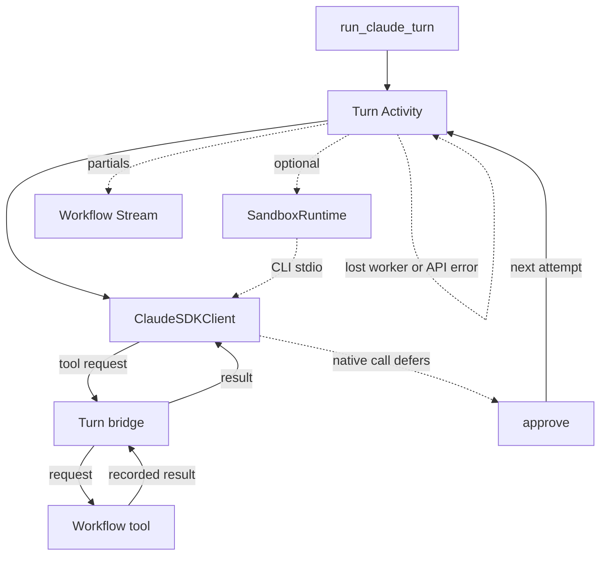

# Claude Agent SDK integration for Temporal

> Release stage: **Pre-release**.

This integration runs the [Claude Agent SDK](https://code.claude.com/docs/en/agent-sdk/python) from Temporal workflows. Each attempt of a turn runs the Claude Code CLI, which owns the agent loop, inside one Activity. Workflow tools, approvals, and session state stay in workflow code.

## Install

```bash
uv add temporalio-claude-agent-sdk
uv add "temporalio-claude-agent-sdk[opentelemetry]"  # turn spans
uv add "temporalio-claude-agent-sdk[modal]"          # Modal sandbox
```

Requires Python 3.11 or newer, `temporalio` 1.34 or newer (below 2), and `claude-agent-sdk` 0.2.165, whose bundled Claude Code CLI is 2.1.294.

## Quickstart

```python
from temporalio import workflow

with workflow.unsafe.imports_passed_through():
    from temporalio.claude_agent_sdk import ClaudeAgentPlugin, run_claude_turn
    from temporalio.client import Client
    from temporalio.worker import Worker

async def get_weather(city: str) -> str:
    """Current weather for a city."""
    return f"sunny in {city}"

@workflow.defn
class Weather:
    @workflow.run
    async def run(self, prompt: str) -> str:
        result = await run_claude_turn(prompt, tools=[get_weather])
        return result.text or ""

async def main() -> None:
    client = await Client.connect("localhost:7233")
    async with Worker(client, task_queue="claude", workflows=[Weather], plugins=[ClaudeAgentPlugin()]):
        print(await client.execute_workflow(
            Weather.run, "Weather in Paris?", id="weather", task_queue="claude",
        ))
```

- Import the package inside `imports_passed_through()`; the plugin installs no sandbox passthrough.
- `tools` are plain async functions that run in the workflow, so external I/O belongs in an Activity they call.
- Bound a turn with `run_claude_turn(..., timeout=...)`, which uses workflow time. Cancelling the awaited call with `asyncio.wait_for` can drop the deadline.
- `ClaudeTurnResult` carries `text`, `structured_output` (validated into `output` when you pass `output_type`), `usage`, `total_cost_usd`, `num_turns`, `stop_reason`, and `duration_ms`. When the CLI reports them, it also carries `duration_api_ms`, per-model `model_usage`, and `permission_denials`.

## Sandbox

By default the CLI runs as a local subprocess. Pass a `SandboxRuntime` to run it in a fresh remote sandbox for each attempt. The workflow stores the opaque snapshot id, and the next attempt starts from it.

```python
from temporalio.claude_agent_sdk.sandbox.modal import ModalSandboxRuntime

plugin = ClaudeAgentPlugin(
    sandbox=ModalSandboxRuntime(
        image=image,  # modal.Image with the pinned Claude Code CLI
        secrets=(modal.Secret.from_name("my-anthropic-secret"),),
    ),
)
```

The SDK client stays on the worker, so workflow tools and partial streams are unchanged. The sandbox gets credentials from the runtime's secrets; neither the workflow payload nor the worker environment is copied in. Snapshot and multi-worker rules are under Sessions.

## Streaming

To watch partial text and thinking while a turn runs, host a `WorkflowStream` and pass `streaming_topic`. A topic with no hosted stream fails the turn before the Activity starts.

```python
from temporalio.claude_agent_sdk import ClaudePartialEvent, run_claude_turn
from temporalio.contrib.workflow_streams import WorkflowStream, WorkflowStreamClient

@workflow.defn
class Streamed:
    @workflow.init
    def __init__(self, prompt: str) -> None:
        self.stream = WorkflowStream()

    @workflow.run
    async def run(self, prompt: str) -> str:
        result = await run_claude_turn(prompt, streaming_topic="claude")
        return result.text or ""

# client, while the workflow runs
async for item in WorkflowStreamClient.create(client, workflow_id).subscribe(
    ["claude"], result_type=ClaudePartialEvent,
):
    print(item.data.attempt_id, item.data.sequence, item.data.text)
```

Each `ClaudePartialEvent` has `attempt_id` (`prompt_uuid.attempt`), `sequence` (from 0 within that attempt), `kind`, `index`, `text`, `thinking`, and `parent_tool_use_id`. Events are batched every `streaming_batch_interval` (100 ms by default). Delivery is advisory and at-least-once: an `(attempt_id, sequence)` pair can repeat, and an attempt abandoned after worker loss can still deliver events. The final `ClaudeTurnResult` is the durable outcome.

### Partial sink

To send partials somewhere other than a Workflow Stream (your own event bus, a UI channel), give the plugin a `partial_sink`. The Activity calls it with batches of every turn's `ClaudePartialEvent` partials and that turn's `streaming_context`, an opaque JSON value the workflow passes to identify where the partials belong. No topic or hosted stream is needed; with a topic as well, both receive every partial.

```python
async def sink(events: list[ClaudePartialEvent], context: Any) -> None:
    if context is not None:
        text = "".join(e.text for e in events if e.text)
        await bus.publish(context["channel"], text)

worker = Worker(client, ..., plugins=[ClaudeAgentPlugin(partial_sink=sink)])

# in the workflow
await run_claude_turn(prompt, streaming_context={"channel": channel_id})
```

Batches arrive in order, at most one per `streaming_batch_interval`, and the last one before the Activity returns. The sink may be sync or async. It runs on its own task, so a slow sink delays its batches but not the turn, though a sink that never returns holds the Activity open. Its delivery is advisory in the same way as the topic's. A sink exception is logged once per attempt and does not fail the turn. `streaming_context` is omitted from the Activity input when unset.

## Feature support

| Capability | Status |
| --- | --- |
| Basic turns and replay | Yes |
| Sessions | Yes |
| Structured output | Yes |
| Workflow tools | Yes |
| Workflow-tool dedup after a lost attempt | Conditional: shared stores or sandbox |
| Cross-worker transcript recovery | Conditional: shared stores or sandbox |
| Continue-as-new | Conditional: `SessionStore` or sandbox |
| Timeout and cancellation | Conditional: kqueue, pidfd, or sandbox |
| Remote sandbox | Conditional: `SandboxRuntime` |
| Partial streaming | Conditional: `streaming_topic` or `partial_sink` |
| Tracing | Conditional: `opentelemetry` extra |
| Native tools | Experimental: verified SDK and CLI pair |
| Native effects | Partial: at-least-once |
| External MCP | Disabled |
| Plugins, skills, and settings | Disabled |
| Claude subagents and background Bash | Disabled |
| Non-POSIX workers | No |

**Yes** is covered by tests or replay. **Conditional** needs the named prerequisite. *Shared stores* means a `SessionStore` and `LeaseStore` that every worker shares, with the same `workspace_root`; *sandbox* means a `SandboxRuntime` with a shared `LeaseStore`. **Experimental** is opt-in and version-gated. **Partial** is not the full guarantee. **Disabled** is forced off. **No** is not exposed.

Structured output also survives stored-transcript resume. The schema sent to the CLI drops Pydantic's `discriminator` and rewrites a tuple's `prefixItems` as `items: {anyOf}`. The workflow validates the reply against the original schema.

## How a durable turn runs



Each attempt is one Activity with `maximum_attempts=1`, because a blind retry would replay model output and tool effects. The workflow itself resumes a lost or API-interrupted attempt by scheduling another Turn Activity, so one logical turn may span several Activities. Work inside a lost attempt, including model calls, can be billed again. This is a deliberate exception to letting the Activity retry policy own retries, so resume backoff shows up in history as workflow timers, not Activity retries.

- **Workflow tools** cross the bridge as signals and updates. When a resumed attempt reissues an identical call (same session, message, tool, canonical input, and ordinal), the recorded result answers it; a rephrased call runs again.
- **Native calls** defer to the workflow's `approve(call)`, then resume in a new attempt. Return `True`, `False`, or `(False, reason)` to tell Claude why. Claude Code honors one deferral per run, so parallel native calls in one message are asked about one at a time; the others are denied with a request to repeat them alone. A missing, false, or raising `approve` denies the call. `native_auto_allow` (a subset of `READ_ONLY_NATIVE_TOOLS`: Read, Glob, Grep, BashOutput) skips the deferral, but the call is still recorded in the native ledger. An auto-allowed Read, Glob, or Grep skips it only inside the session's working directory, after resolving symlinks; any other path goes to `approve`. WebFetch and WebSearch always ask, because a URL or a search query can carry what Claude read off the worker. After worker loss, a repeatable native call may run again; a nonrepeatable call with an uncertain outcome fails closed.
- **Cancellation** reaches a running turn within about a second: the turn heartbeats every second, and `ClaudeAgentPlugin` caps the worker's `max_heartbeat_throttle_interval` at one second (for every Activity on that worker). A native call left awaiting approval is answered as expired in the transcript before the session's next message runs.
- **Failures** carry `error_kind` in their details. `rate_limit` and `server_error` back off and resume like a 429 or 5xx, but only with a `SessionStore`. An attempt that hit `authentication_failed`, `billing_error`, `invalid_request`, `account_on_hold`, `model_not_found`, `oauth_org_not_allowed`, or `verification_required` is never resumed.

## Sessions

`ClaudeSession` continues one conversation, one turn at a time. `session.snapshot()` returns a serializable `ClaudeSessionState`; pass it to the next run and rebuild with `ClaudeSession.restore(state, activity_config=...)` to continue-as-new.

`ClaudeTurnOptions(max_turns=..., max_budget_usd=...)` caps one message across its attempts. `ClaudeSession(max_cost_usd=...)` caps the whole session, and the cap and spend carry through the snapshot. Each message's budget is lowered to what the session has left, and once spend reaches the cap the next message fails as `ClaudeTurnBudgetExhausted` without scheduling an Activity. Claude Code checks the budget between model calls, so one call can overshoot it slightly. Failed runs count too. Claude Code reports spend only with a run's result, so the model calls of an attempt lost before its result are not charged. A cancelled attempt is charged what its interrupted CLI reports, which can be less than it spent.

Cross-worker resume needs a shared `SessionStore`, a shared `LeaseStore`, and the same canonical `workspace_root` on every worker: a session runs in `<workspace_root>/<session_id>`, and its store key is derived from that path. A `WorkspaceStore` also moves the files native tools wrote. A missing or corrupt snapshot fails restore and leaves the worker directory untouched.

```python
ClaudeAgentPlugin(
    session_store=FileSessionStore("/mnt/shared/claude-sessions"),
    lease_store=FileLeaseStore("/mnt/shared/claude-leases"),
    workspace_root="/mnt/shared/workspaces",
    workspace_store=SharedDirWorkspaceStore("/mnt/shared/snapshots"),
)
```

`FileSessionStore` keeps one JSONL file per session, appended under `flock` with `uuid` dedupe and an fsynced atomic replace. Use it on one host or on a filesystem every worker mounts with working `flock` and `rename` (NFSv4, not SMB or object-storage mounts). Each append rewrites the session's file, so prefer a database-backed `SessionStore` for large transcripts. Without a shared filesystem, `ModalVolumeWorkspaceStore.from_name("claude-workspaces")` (the `modal` extra) keeps snapshots in a Modal Volume and claims revisions in a Modal Dict.

Retention is the store adapter's job. The SDK never deletes from a `SessionStore`, and a run resumed from the store works in a temporary config directory the SDK removes afterwards, so the store holds the only lasting copy of resumed runs. A session's first run also writes its transcript under the worker's Claude config directory (`~/.claude/projects`), which is left to Claude Code's `cleanupPeriodDays` cleanup.

Authenticate the CLI with `ANTHROPIC_API_KEY` (or another environment credential: `CLAUDE_CODE_OAUTH_TOKEN`, Bedrock, Vertex) or with managed settings. Turns run with `setting_sources=[]`, so user and project settings, including an `apiKeyHelper`, never load. A run resumed from the store gets a copy of `.credentials.json` without its refresh token, so a `claude login` session cannot refresh there.

The lease generation fences stale attempts. SessionStore 0.2.165 has no conditional write, so one batch already past its generation check can still commit after a takeover. Ordinary cancellation waits for workspace restore to finish before releasing the lease. A filesystem restore already in progress when ownership is lost cannot be fenced by waiting; do not share a live workspace directory between workers that can overlap after takeover. Workspace snapshots may still be shared between workers with separate local workspace directories at the same canonical path.

With a sandbox, the snapshot is the transcript and the files, so `session_store` and `workspace_store` are rejected. The lease is still taken, and each sandbox is tagged with its generation. `terminate_strays` terminates only older generations of the session, and it does not delete snapshots. Failover of a lost attempt needs a `lease_store` that every worker shares. A single worker may omit it, but then a lost attempt fails the message instead of resuming. Work after the last committed snapshot is lost. Transient API errors, and a CLI that exits without a result, are not auto-resumed in sandbox mode, because resuming either needs a `SessionStore`.

## Observability

Existing Temporal APIs expose session status without plugin support. Register custom search attributes in the namespace before upserting them.

```python
STATUS = SearchAttributeKey.for_keyword("ClaudeStatus")

@workflow.query
def claude(self) -> dict[str, Any]:
    state = self._claude.snapshot()
    return {"session_id": state.session_id, "cost_usd": state.cost_usd, "max_cost_usd": state.max_cost_usd}

# in a handler
workflow.upsert_search_attributes([STATUS.value_set("running")])
workflow.set_current_details(f"Claude spent ${self._claude.state.cost_usd:.2f}")
reply = await run_claude_turn(text, session=self._claude, activity_config={"summary": f"Answer {ticket}"})
```

Each Turn Activity's summary defaults to `Claude turn (<model>)`. The workflow metric meter counts each settled message as `claude_turns`, with an `outcome` attribute (`success`, `refusal`, `failure`, or `cancelled`) and a `model` attribute; it records nothing during replay. Entries in the `<sandbox_violations>` blocks Claude Code appends to sandboxed Bash results are returned as `ClaudeTurnResult.sandbox_violations` and counted as `claude_sandbox_violations` (attribute `model`). Treat it as a signal, not enforcement: Claude Code does not report Linux filesystem denials, and its macOS log monitor can drop entries. With the `opentelemetry` extra, each attempt emits an `invoke_agent Claude Code` span with `chat` and `execute_tool` children.

## Limitations

- **Model calls** are not recorded as Activities, so a lost attempt's model calls are billed again; routing them through Temporal is a possible future opt-in mode.
- **Credentials** stay on the worker, which authenticates the CLI with `ANTHROPIC_API_KEY`, `CLAUDE_CODE_OAUTH_TOKEN`, or Bedrock or Vertex credentials. Native Bash does not see variables that match `native_env_denylist`. In a sandbox the worker cannot see the runtime's secrets, so Bash is denied them by name: common provider credentials (Anthropic, AWS, Google, GitHub) and the denylist's literal names. List any other secret's exact name in `native_env_denylist`.
- **Workflow history is not a secret store.** Prompts, replies, workflow tool arguments and results, and native call keys (including Bash command strings) are stored in it. Protect sensitive sessions with namespace access controls and retention, and encrypt payloads with a client-side payload codec. Credentials stay on the worker or in Modal Secrets and never enter payloads; span content is recorded only with `OTEL_INSTRUMENTATION_GENAI_CAPTURE_MESSAGE_CONTENT=true`.
- **Native tools** stay off unless `enable_native_tools=True` and the SDK and the CLI the turn runs are 0.2.165 and 2.1.294.
  - Locally, native tools need Seatbelt on macOS, or `bwrap` and `socat` on Linux. A Linux worker also needs sandbox-runtime's seccomp helper (`npm install -g @anthropic-ai/sandbox-runtime@0.0.79`), which Claude Code would otherwise skip silently; `require_seccomp_helper=False` opts out. Remotely, the runtime must report `supports_native_tools`; for Modal that means `runtime="vm"` and an image with bubblewrap, socat, python3, and tar.
  - A turn may request only the built-ins in `NATIVE_TOOL_EFFECTS`. Bash with `run_in_background` is denied.
  - Every call goes through a gate hook; a hook that fails or times out denies the call.
  - The file tools and Bash are denied, even after approval, on `/proc`, `/sys`, the plugin's native-tool state and process-group directories, `~/.aws`, `~/.ssh`, `~/.modal.toml`, `~/.config/gcloud`, and the Claude config directory (`~/.claude` and any `CLAUDE_CONFIG_DIR`). On macOS 2.1.294 Seatbelt does not follow a denied path that is a symlink to its real location (fixed in 2.1.299).
  - No native tool can create or change a `.git` directory. Claude Code runs `git status` unsandboxed when the CLI starts, and git runs any clean filter that the repository's `.git/config` names, so do not restore a workspace whose `.git` you do not trust.
  - Bash has no network: the sandbox allowlist is empty and strict, so a call cannot widen it, and local binding and Unix sockets are off.
  - Sessions on one worker are not isolated from each other: Bash can read the other session directories under `workspace_root` and Claude Code's per-user temp directory. Use separate workers or a sandbox runtime when sessions must not see each other.
  - A host whose Claude Code managed settings (`managed-settings.json`, its `managed-settings.d/*.json` drop-ins, or the cached server-managed `remote-settings.json`) set `sandbox`, `permissions`, `env`, `allowManagedHooksOnly`, `allowManagedPermissionRulesOnly`, or `disableAllHooks` refuses native tools. MDM profiles are not detected. Managed `CLAUDE.md` files, auto memory, and claude.ai MCP connectors are always off.
  - A process that a command detaches (`nohup x &`, `setsid -f x`) is killed when the turn ends. On macOS, Apple's system binaries hide their environment and are missed.
- Claude Code's Bash sandbox (Seatbelt or bubblewrap around a command) is a native-tool setting, not a `SandboxRuntime`.
- **Prompts** reach Claude verbatim: `@path` attaches nothing and a leading `/` is not a slash command. The CLI always runs with `CLAUDE_CODE_RESUME_*` recovery and background tasks off, and accepts messages up to 32 MiB.
- **A custom `cli_path`** may run fresh turns, but it can resume only at the verified pair. An unknown or unparsed version is refused.
- **Process tracking:** local turns need kqueue or pidfd to kill the CLI's process group when the worker dies. A POSIX host with neither, or a non-POSIX worker, refuses local turns.
- **Modal** sandboxes have open egress by default. Set `ModalSandboxRuntime(outbound_domain_allowlist=("api.anthropic.com",))`, plus the host of any `ANTHROPIC_BASE_URL`, to limit it to the model API. Snapshots expire after `snapshot_ttl` (30 days by default). A stray sandbox lives until a newer generation of its session runs, or until `timeout` (1 hour by default).
- **Tracing:** turn spans are created in the Activity and passed to the CLI as `TRACEPARENT`. Register Temporal's `OpenTelemetryPlugin` on the client to parent them to the workflow. Set `OTEL_INSTRUMENTATION_GENAI_CAPTURE_MESSAGE_CONTENT=true` to record prompts, replies, and tool payloads.

## Testing

`make test` runs the offline suite against a local dev server. `FakeClaudeCLI` from `temporalio.claude_agent_sdk.testing` replays scripted CLI output:

```python
from temporalio.claude_agent_sdk.testing import FakeClaudeCLI, text_turn

cli = FakeClaudeCLI(tmp_path, turn=text_turn("Hello!"))
plugin = ClaudeAgentPlugin(cli_path=cli.cli_path)
```

`tests/coding_assistant/` is an example agent: a workflow that hands each message from a planner to a coder to a reviewer, one module per role, with workflow tools, an allowlist approval policy, streaming, spending caps, and continue-as-new. `tests/test_claude_coding_assistant.py` runs it offline against `FakeClaudeCLI`, including a SIGKILL of the worker process mid-turn, after which a second worker finishes the message from shared stores without repeating the workflow tool or the approved edit. Its history is replayed, and a gated live test runs two messages on the real CLI; worker loss is tested only offline.

There are 25 live tests, all skipped in CI. `CLAUDE_REAL_CLI=1` enables `tests/test_claude_real_cli.py` and `tests/test_claude_sandbox_conformance.py`; their real turns also need `CLAUDE_REAL_CLI_NETWORK=1` and `ANTHROPIC_API_KEY`. The conformance file's `xfail(strict=True)` tests are gaps in Claude Code 2.1.294; one that starts passing after an upgrade fails the run. `tests/test_modal_sandbox_real.py` needs `MODAL_TOKEN_ID`, `MODAL_TOKEN_SECRET`, and either `ANTHROPIC_API_KEY` or `CLAUDE_MODAL_SECRET`.
